# Starcape 主题迁移验收

> 2026-10-20：宿主改为 C++ 原生扩展运行时后，主题包由 CMake（宿主 SDK 的 `NekoTunePackage.cmake`）生成。宿主测试工程中的 `nekotune_starcape_test` 以原生运行时导入真实主题包并通过；主题内容未改动。下文为迁移当时（Node 运行时）的记录。

本次把 `feat/starcape-ui-redesign` 的 `46b00fa` 改版提取为独立主题包，原分支保留。主题源码、制作工具、测试和预览放在 `NekoTune-extensions/starcape`，宿主不捆绑或自动启用它。

## 实现范围

- 保留原分支的图标导航栏、悬浮播放胶囊、卡片首页、曲库列表／封面网格、分组设置、星座空状态与默认封面。
- 深色使用原分支配色，补充浅色。字体、间距、圆角等公共变量交给宿主主题控制器；明暗切换不会销毁 Shell。
- 外观入口可切换主题及恢复默认；托盘设置和宿主恢复快捷键保留。
- 主题直接消费共享 C++ 控制器。没有 Node 入口，不创建 Worker，不修改音乐文件、播放实现或独立扩展选择。
- 宿主增加完整 Shell 的 `focusSearch(): void` 动作转交，通过 C++ 调用避免跨 QML 引擎保存页面 JavaScript 对象。相应协议说明和回归测试已补充。

## 1.1.1 首页与设置功能补齐（2026-10-20）

旧版 Starcape 复制的页面落后于当前宿主。本次保留星空布局，补齐最近播放、听歌统计与热力图、听歌历史路由、首页歌曲队列菜单，以及音频引擎、倍速、音乐库管理和辅助窗口设置。复用宿主业务组件，设置导航可滚动；同时修复旧歌曲菜单委托在销毁时读取空父对象宽度的问题。

- `pnpm check`、`pnpm test` **2/2**、`pnpm build` 和 ZIP CRC 检查通过。完整主题导出／导入保留首页、设置、路由、壁纸和资源；新增检查确保主题覆盖宿主的全部内置页面路由。
- 从最终 ZIP 安装的 Linux 集成测试 **3/3**（含初始化与清理）通过，12.287 秒。实际检查最近入库／播放切换、排序与无播放记录提示、原模型顺序保持、听歌统计加载、历史页导航与真实播放记录、歌曲菜单加入队列、音频引擎和备份／恢复入口、迷你置顶、打开／返回迷你模式、1.25 倍速与重置、1000×640 设置分组及外观入口。原有主题重载、更新、壁纸和播放状态保持回归仍通过。
- 首页、设置面板、设置页的 `qmllint` 为 **0 错误、0 警告**；全部 7 个改动 QML 合计 0 错误、28 条非限定访问警告，来自共享上下文和原有委托访问。集成测试捕获的 QML 警告列表为空；offscreen 平台的两条 `raise()` 不支持提示来自迷你窗口恢复。
- 截图检查了深色中文音频引擎、音乐库、辅助窗口、窄窗口设置，以及浅色英文首页和历史。测试在临时资料中使用真实宿主／后端和模拟音频；备份／恢复入口已检查，未在此测试中执行完整数据迁移。音频 DSP、真实桌面平台、Windows、GPU 和真实声卡没有新增验收结论。

当前 ZIP：`dist/nekotune.theme-starcape.nktheme.zip`，SHA-256：

```text
19e1f0d4984a2f1838d71344911170ec37015f52cbaccd9883062e47c2c8d2f7
```

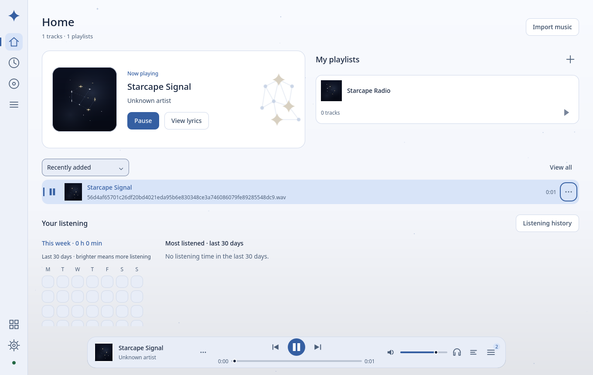

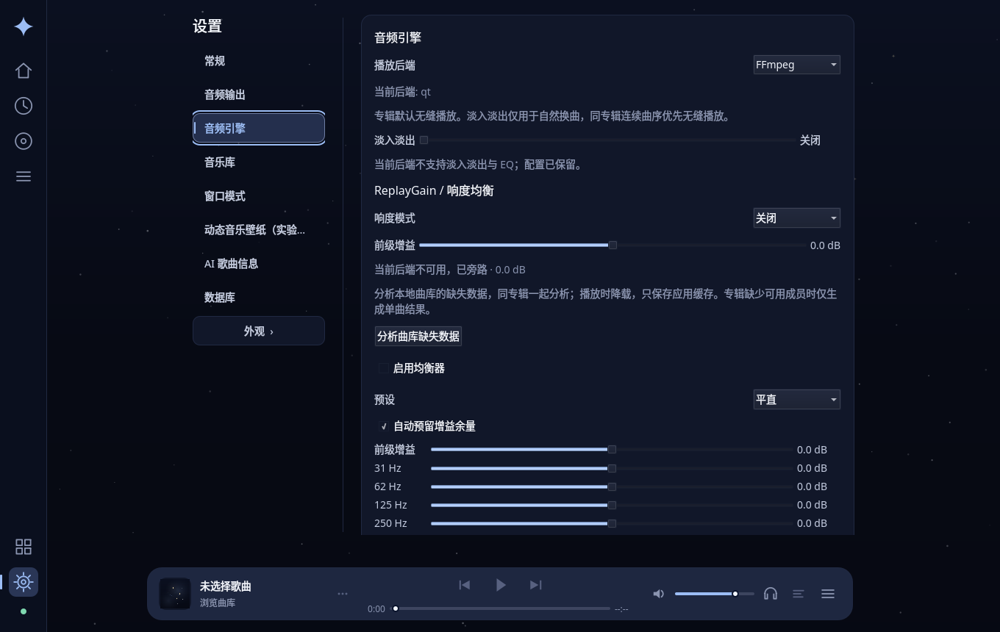

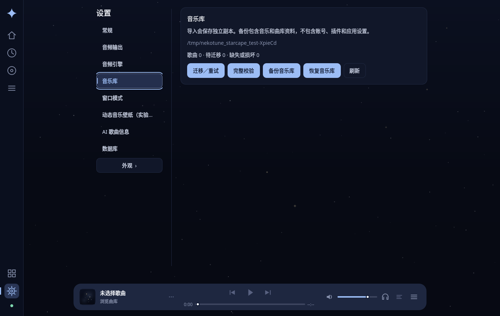

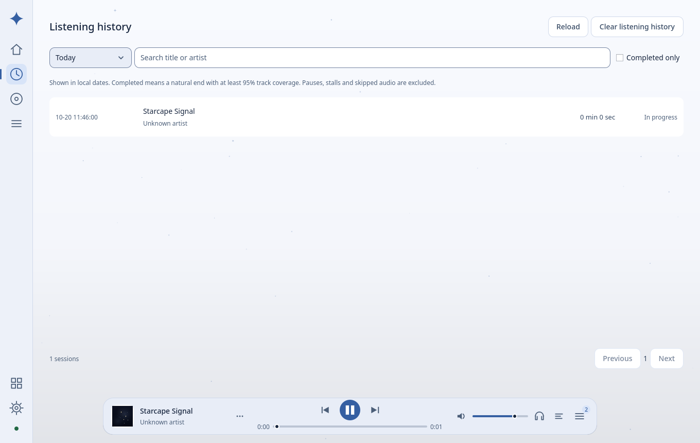

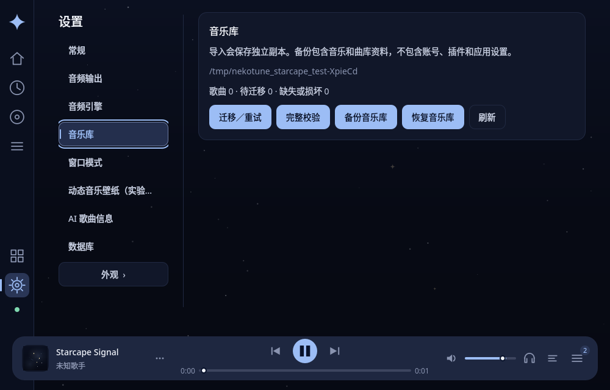

本次日志：宿主工作区 `build/starcape-parity-build.log`、`build/starcape-parity-test.log`、`build/starcape-parity-lint.log`；实际截图位于 `build/starcape-parity-evidence/`。

## 1.1.0 星空音乐壁纸（2026-10-20）

新增 `ui.wallpaper: "qml/Wallpaper.qml"`，复用已有静态星尘、星座和封面，增加随播放呼吸的光晕、歌曲信息、进度与宿主同步歌词。Starcape 分组设置新增「动态音乐壁纸」，直接复用宿主设置卡片；宿主完整 Shell 通过 `api.window.wallpaper` 暴露管理器。原有主题 ID 和配色保持一致。

- `pnpm check`、`pnpm test`、`pnpm build` 和 ZIP CRC 检查通过；主题资源可完整导出／导入。
- 壁纸与设置面板的 qmllint 0 错误、0 警告；宿主桌面与独立前端构建成功。
- 实际 ZIP 安装集成测试 3/3（含初始化与清理）通过：从 Starcape 设置选择主题壁纸并启用、关闭后重开、暂停／恢复、零装饰强度、歌词开关、明暗切换、重新加载和恢复默认。重载不替换壁纸原生窗口，关闭壁纸不停止播放，运行时捕获的 QML 警告为空。
- 检查了 1280×800 横屏、720×1280 竖屏与 360×240 紧凑布局的内容边界及截图。测试使用 Linux offscreen 软件渲染、临时音乐目录和模拟音频设备；截图中的测试歌曲没有歌词，显示未找到歌词的回退状态。没有新增真实音频、Windows、多屏或性能验收结论。

1.1.0 当时 ZIP：`dist/nekotune.theme-starcape.nktheme.zip`，SHA-256：

```text
3ec26795d0dfc90efe54294d38a40e8ca172eed1ff4bb80943aa01234ac14a72
```

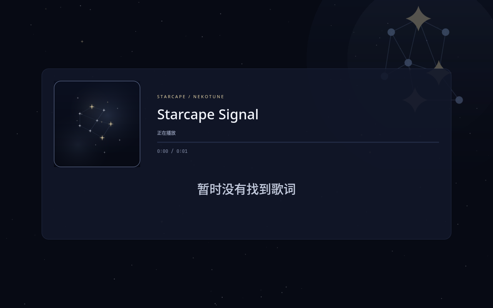

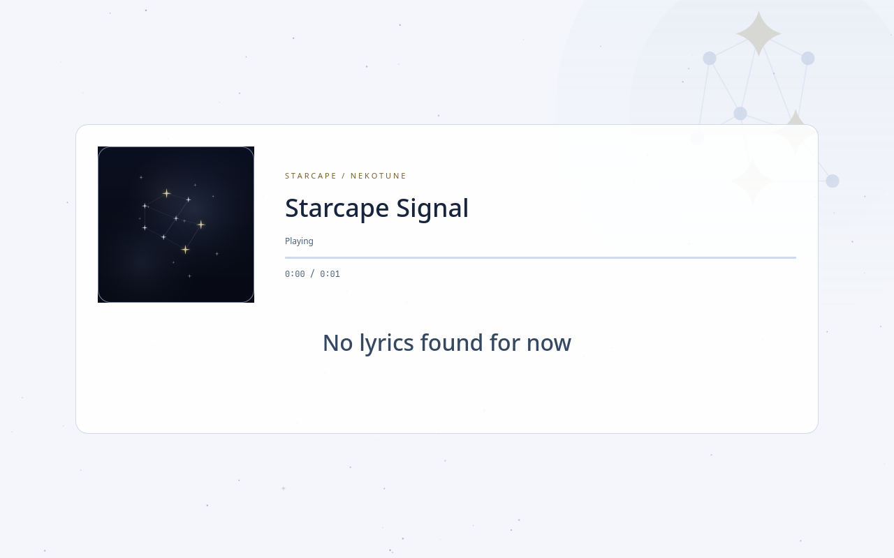

竖屏预览见 [wallpaper-portrait.png](preview/wallpaper-portrait.png)。

## 1.0.2 主题更新与重新加载

宿主外观页显示导入主题的包版本，增加「更新主题包」与「重新加载」。定向更新先校验同一包 ID，再确认替换；取消、选错包时保留原安装。重新加载读取安装目录，更新 ZIP 必须通过更新入口。Starcape 外观页改为复用宿主面板，避免今后遗漏管理功能；被隐藏的面板不再响应全局确认信号。

本次 Linux 构建、完整 CTest **21/21**（77.29 秒，含 30 项 Node 测试及 Starcape 测试）、SDK 类型检查、主题资源往返和 ZIP 校验均通过。Linux 安装包生成成功，隔离配置下桌面与独立后端的 SQLite、IPC、捆绑 Node、主题导入／导出冒烟检查通过。宿主外观页及 Starcape 复用组件的 qmllint 为 **0 错误、0 警告**。从已安装 ZIP 实际点击重新加载，验证旧 Shell 释放，并走过更新取消与确认；显示模式、主题选择、当前歌曲、队列及播放状态不变。完整 Shell 内渲染的深色中文、浅色英文页面和替换确认框已截图检查。

## 1.0.1 播放胶囊微调

根据实际播放截图收紧布局：播放按钮最大 40 px，上下两行总高度控制在胶囊内；封面改为 44 px 并保留细边框，右侧按钮与音量滑条间距统一。进度条未播放部分提亮，队列数量使用独立小角标，超过 99 首显示 `99+`，完整数量仍见提示文字。

此次修改只涉及主题 QML，已重新通过 ZIP 安装／交互回归（QtTest 3/3，含初始化与清理）、主题资源往返测试和打包；单文件 qmllint 0 错误、5 条非限定访问警告。深色窄窗口和浅色截图已重新检查。1.0.1 当时沿用主题迁移基线，未重复全套测试；1.0.2 的完整结果见上节，下方预览与包校验现已更新到 1.0.2。

## 1.0.0 迁移基线的自动化证据

| 检查 | 结果 |
| --- | --- |
| Linux 构建 | `cmake --build build -j2` 成功 |
| 完整 CTest（含专用 Starcape 测试） | 21/21 通过，101.49 秒 |
| 主题校验、资源往返、ZIP 生成 | `pnpm check`、`pnpm test`、`pnpm build` 均通过 |
| qmllint | 43 个文件，0 错误、381 条警告：373 条非限定访问、8 条静态属性类型警告 |
| 运行时 QML | 集成测试捕获的警告列表为空 |
| 补丁空白检查 | `git diff --check` 通过 |

实际集成测试从 ZIP 安装到临时音乐目录，验证导入不执行、首次信任、主题启用、导航、新建歌单、搜索快捷键、封面网格、明暗切换保留 Shell 实例、恢复窗口快捷键、反复卸载／加载释放旧实例，以及通过外观页恢复默认。期间播放状态、当前歌曲和队列保持一致。使用真实后端和模拟音频设备，未访问用户音乐资料或外部账号。

主题包为 `dist/nekotune.theme-starcape.nktheme.zip`：45 个文件，压缩后 202495 字节，解压内容 430599 字节，ZIP CRC 检查通过。SHA-256：

```text
c2bdfe8cfc7db4965f31cbc36a9b3701970d1992799e89812b3523ae4b4980f2
```

## 实际截图

Linux、Qt 6.11.2、Qt Quick 软件渲染；截图来自真实宿主加载已安装主题后的窗口。

深色中文首页（1360×860）：图标导航、星空封面和悬浮播放胶囊符合分支布局。

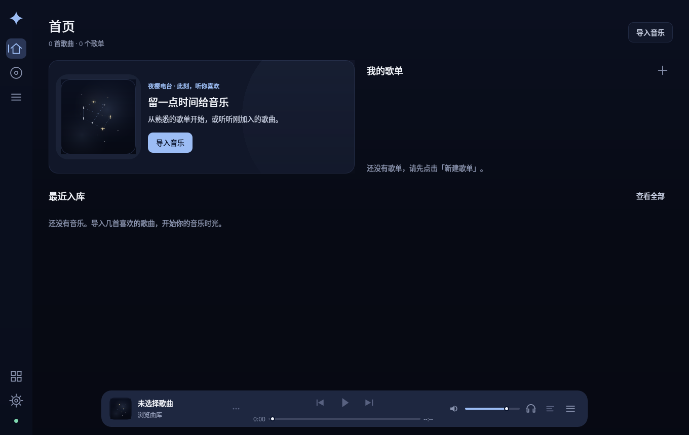

浅色英文首页（1360×860）：补充冷白背景与深蓝文字，正在播放的歌曲来自临时 WAV 测试资料。

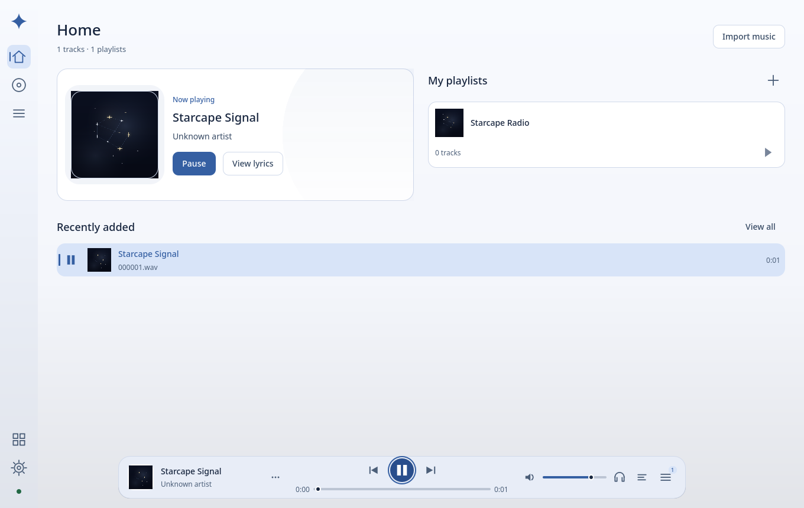

封面网格与当前歌曲播放标记正常。

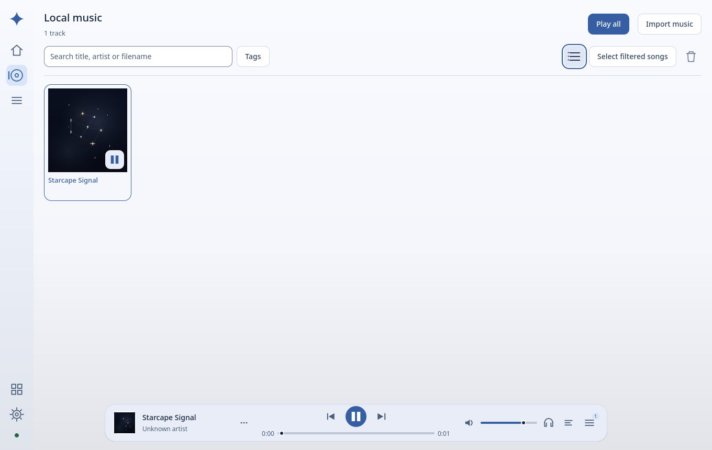

窄窗口（1000×640）：首页区域纵向排列，播放胶囊和底部导航保持可访问，内容通过滚动浏览。

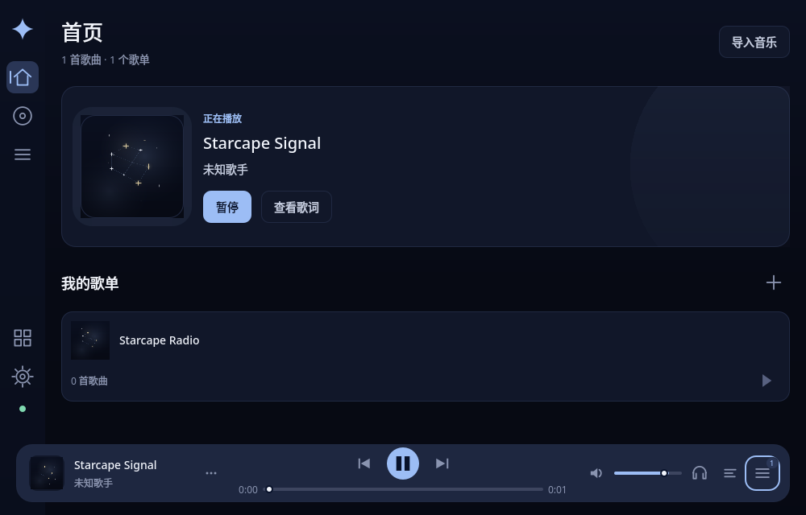

外观页仍可在 Starcape 内管理主题和显示模式。

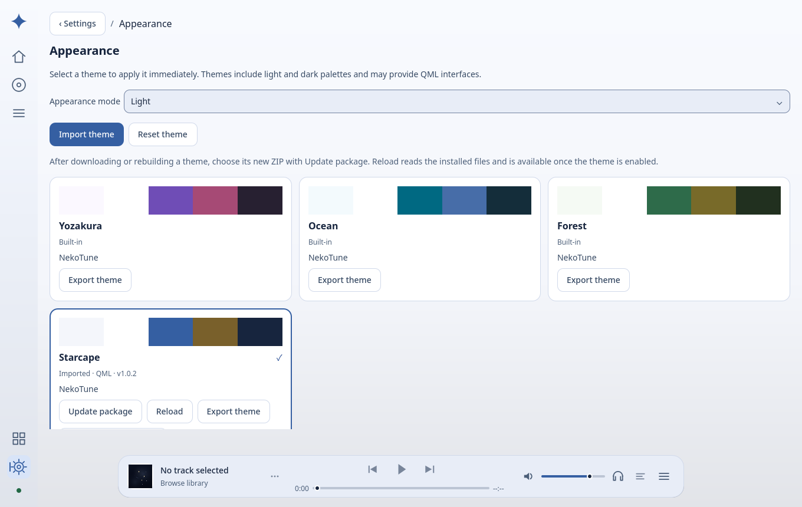

更新确认框由当前显示的外观面板处理。

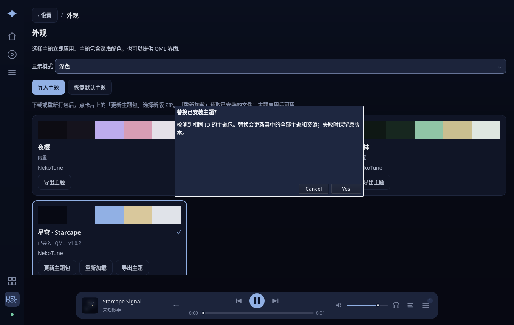

## 验收边界

本次未进行 Windows 原生构建、GPU 渲染、真实声卡、真实桌面明暗切换或第三方在线音源登录测试。包内 QML 与宿主共享 GUI 线程，使用现有扩展信任机制；遇到阻塞仍需 `--safe-mode` 恢复。主题需要本次带主题功能的宿主构建，不能直接用于缺少该接口的旧正式版。

本机临时日志：`/tmp/nekotune-starcape-build.log`、`/tmp/nekotune-starcape-ctest.log`、`/tmp/nekotune-starcape-qmllint.log`。临时日志可被系统清理；本文及 `preview/` 保留关键验收结果。

1.0.1 微调日志：`/tmp/nekotune-starcape-polish-test.log`、`/tmp/nekotune-starcape-polish-lint.log`。

1.0.2 更新入口日志：`/tmp/nekotune-theme-refresh-build.log`、`/tmp/nekotune-theme-refresh-ctest.log`、`/tmp/nekotune-theme-refresh-starcape.log`、`/tmp/nekotune-theme-refresh-lint.log`。

1.0.2 Linux 打包与冒烟日志：`/tmp/nekotune-theme-refresh-package.log`、`/tmp/nekotune-theme-refresh-smoke.log`。
